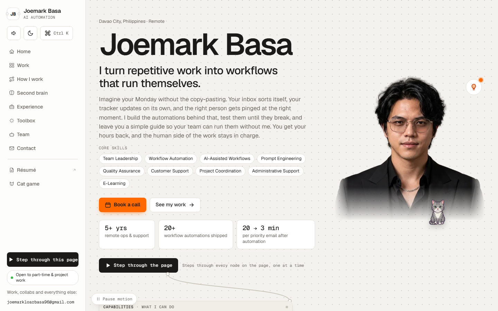
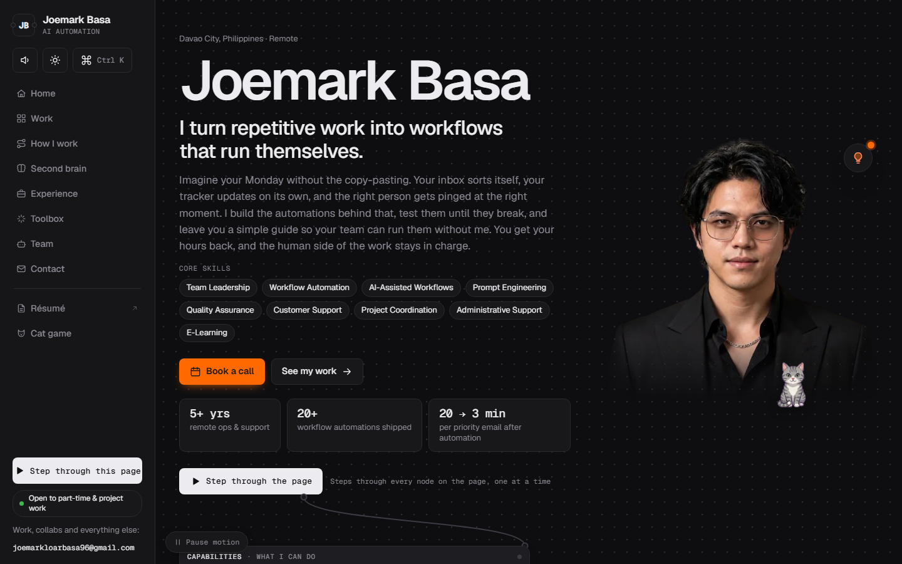
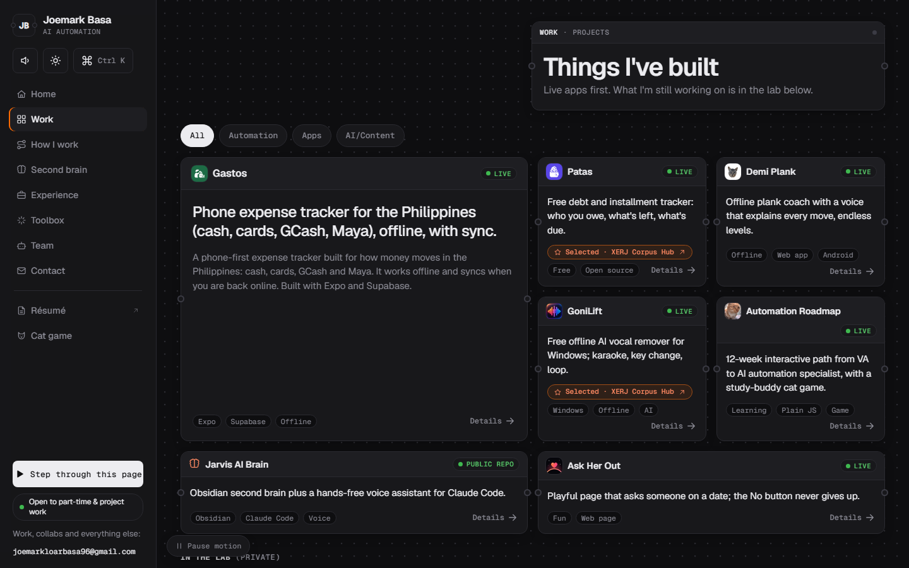
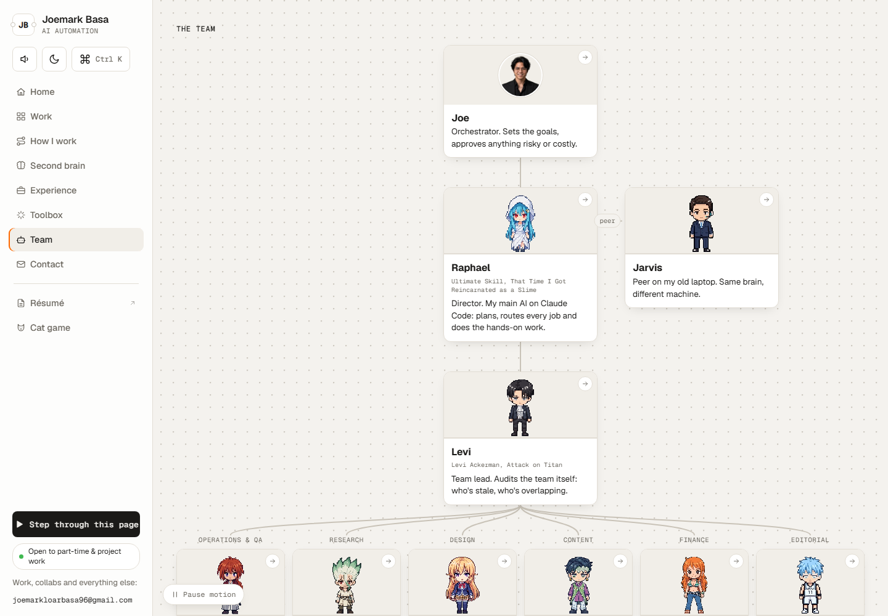
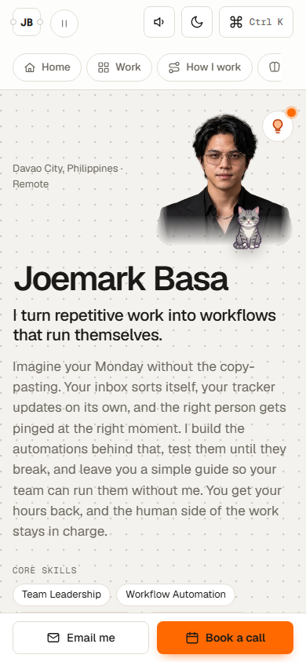

# Joemark Basa — portfolio

**Live site: https://markbasa96.github.io**

My own portfolio, résumé and contact page in one. It is built like a workflow canvas: every part of the page is a node, and a "Run workflow" button walks you through them one by one.

| Home (light) | Home (dark) |
|---|---|
|  |  |

| Work | Team | Phone |
|---|---|---|
|  |  |  |

## What is on it

- **Home** with a short pitch, three headline numbers, what I can do for you, and my live apps.
- **Work**: live projects with details, filters, and a private "in the lab" list.
- **How I work**: the five steps every job goes through, drawn as a small workflow.
- **Second brain**: a 3D graph of the note titles in my Obsidian vault (titles only).
- **Experience**, **Toolbox**, **Team** (my AI agents as an org chart, each with a modal), and **Contact**.
- **Book a call** opens my Google Calendar booking page.
- A portrait that follows your cursor, a light switch that puts me to sleep, a pixel cat called Demi, and a small cat game.
- Light and dark theme, phone layout with a tab strip, keyboard command palette (`Ctrl K`), soft click and hover sounds with a mute button, and a "Pause motion" switch. Reduced-motion settings are respected.

## How it is built

Plain HTML, CSS and JavaScript. No framework, no build step, no package manager.

| File | What it does |
|---|---|
| `index.html` | Page shell, tab panels, dialogs, and an inline copy of the data for first paint |
| `style.css` | Theme tokens, layout, node and wire styling |
| `app.js` | Rendering, tabs, workflow runner, face, cat, sounds, command palette |
| `brain.js` | The 3D second-brain graph (three.js, loaded from `assets/brain/`) |
| `game.js` | The cat mini game |
| `data/projects.json` | Every project card |
| `data/profile.json` | Name, text, stats, experience, toolbox, team |
| `data/brain.json` | Note titles for the graph |
| `assets/` | Face frames, cat sprites, team sprites, app icons, tool logos, clips |

## Run it locally

Any static server works. For example, from this folder:

```powershell
python -m http.server 8000
```

or open `index.html` directly (the data refresh from the JSON files is skipped on `file://`, the page still works from the inline copy).

## Add a project

Add one object to `data/projects.json` with `id`, `name`, `one_liner`, `status`, `visibility` (`public` or `private`), `tags` and, for public ones, `url` and `repo`. Private projects show a name and a line only, never links. If you change `data/profile.json`, update the inline copy in `index.html` too (the `data-profile` script block) so first paint matches.

## Credits and notes

- Built with [Claude Code](https://claude.com/claude-code).
- The photos and clips of me are AI-generated from my likeness (Google Flow), so I look a little less polished on a call. Still me, just enhanced.
- The team avatars are pixel fan art of each agent's namesake character.
- The pixel cat sheet was generated in Google Flow.
- 3D graph uses [three.js](https://threejs.org) (MIT, license in `assets/brain/LICENSE`).
- Tool and app logos belong to their owners and are shown only to name the tools I use.

© 2026 Joemark Basa. All rights reserved. Please do not copy the portrait, the personal text, or the character art.

## SEO files and auto-update
`llms.txt`, `sitemap.xml`, `robots.txt`, `manifest.webmanifest` and the `<noscript>` project list help search and AI engines read the site. When `data/projects.json` changes, run `node tools/update-seo.js` (a local git pre-commit hook does it automatically) to refresh the project list, sitemap date and noscript block. The share image is `assets/og.png`.
